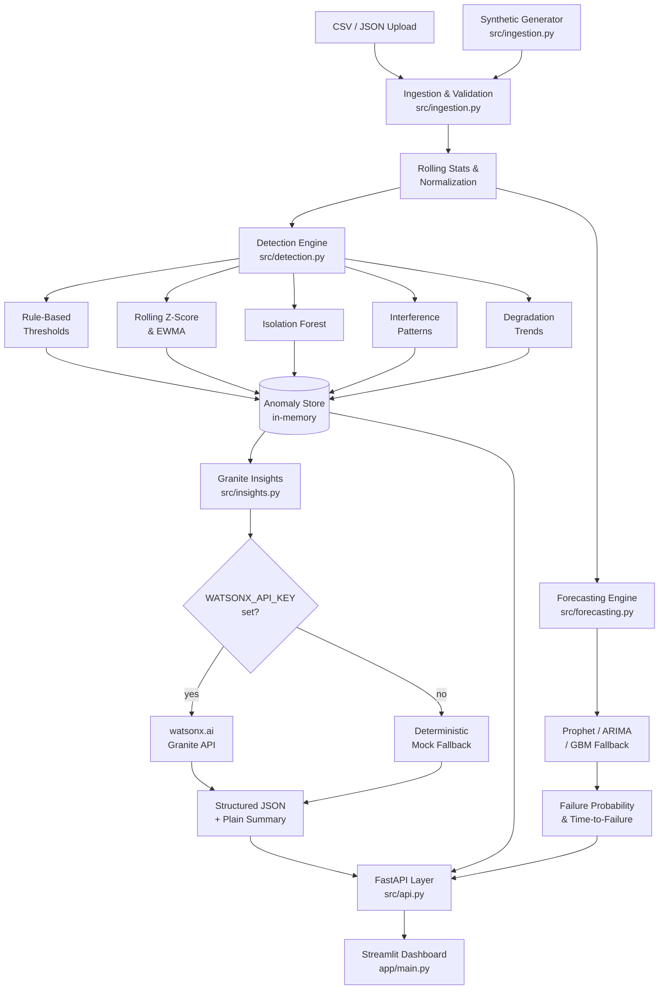

# AI-Powered Signal Quality Analyzer

> **Problem Statement No. 25** — Intelligent signal quality monitoring for telecom systems using IBM Granite (watsonx.ai), anomaly detection, forecasting, and a Streamlit dashboard.

---

## Architecture



---

## Project Structure

```
AI-signal quality analyzer/
├── app/
│   └── main.py               # Streamlit dashboard (6 tabs)
├── src/
│   ├── ingestion.py          # Schema validation, cleaning, rolling stats, synthetic gen
│   ├── detection.py          # Anomaly detection, interference, degradation
│   ├── forecasting.py        # Prophet/ARIMA/GBM, failure risk, TTF
│   ├── insights.py           # IBM Granite via watsonx.ai + mock fallback
│   └── api.py                # FastAPI REST endpoints
├── tests/
│   ├── test_ingestion.py
│   ├── test_detection.py
│   └── test_forecasting.py
├── data/                     # Drop CSV/JSON datasets here
├── .env.example
├── Dockerfile
├── requirements.txt
└── README.md
```

---

## Quick Start (Local)

### 1. Clone & install

```bash
git clone <repo-url>
cd "AI-signal quality analyzer"

python -m venv .venv
# Windows:
.venv\Scripts\activate
# macOS/Linux:
source .venv/bin/activate

pip install -r requirements.txt
```

### 2. Configure environment (optional — needed only for real Granite insights)

```bash
cp .env.example .env
# Edit .env and fill in WATSONX_API_KEY and WATSONX_PROJECT_ID
```

### 3. Run the dashboard

```bash
streamlit run app/main.py
```

Open **http://localhost:8501** in your browser.  
Click **Generate & Analyze** in the sidebar to load the built-in synthetic dataset — no file upload or credentials needed.

### 4. Run the REST API (optional)

```bash
cd src
uvicorn api:app --reload --port 8000
```

Swagger UI: **http://localhost:8000/docs**

---

## REST API Reference

| Method | Endpoint | Description |
|--------|----------|-------------|
| `POST` | `/upload` | Upload CSV/JSON or generate synthetic data |
| `GET`  | `/anomalies` | Anomaly list, interference & degradation events, node health |
| `GET`  | `/insights` | IBM Granite AI insights (cached; `?refresh=true` to rerun) |
| `GET`  | `/forecast` | Per-node forecasts + failure risk ranking |
| `GET`  | `/health` | Service liveness + dataset summary |
| `GET`  | `/nodes` | List node IDs + health scores |
| `GET`  | `/raw` | Cleaned time-series data |

**Upload synthetic data via API:**
```bash
curl -X POST "http://localhost:8000/upload?use_synthetic=true&n_nodes=5&hours=48"
```

**Upload your own CSV:**
```bash
curl -X POST "http://localhost:8000/upload" \
  -F "file=@data/my_signals.csv"
```

---

## Running Tests

```bash
pytest tests/ -v --tb=short
```

With coverage:
```bash
pytest tests/ --cov=src --cov-report=term-missing
```

---

## Docker

### Build & run locally

```bash
docker build -t signal-analyzer .

# Streamlit dashboard
docker run -p 8501:8501 \
  -e WATSONX_API_KEY=your_key \
  -e WATSONX_PROJECT_ID=your_project_id \
  signal-analyzer

# FastAPI only
docker run -p 8000:8000 signal-analyzer \
  python src/api.py
```

---

## IBM Cloud Deployment (Code Engine)

### Prerequisites
```bash
ibmcloud login --sso
ibmcloud plugin install code-engine
ibmcloud plugin install container-registry
```

### 1. Push image to IBM Container Registry

```bash
ibmcloud cr login
ibmcloud cr namespace-create signal-analyzer-ns

docker tag signal-analyzer \
  us.icr.io/signal-analyzer-ns/signal-analyzer:latest

docker push us.icr.io/signal-analyzer-ns/signal-analyzer:latest
```

### 2. Create a Code Engine project and deploy

```bash
ibmcloud ce project create --name signal-analyzer-proj
ibmcloud ce project select --name signal-analyzer-proj

# Create a registry secret
ibmcloud ce secret create-registry --name icr-secret \
  --server us.icr.io \
  --username iamapikey \
  --password $IBMCLOUD_API_KEY

# Deploy as a Code Engine application
ibmcloud ce application create \
  --name signal-analyzer \
  --image us.icr.io/signal-analyzer-ns/signal-analyzer:latest \
  --registry-secret icr-secret \
  --port 8501 \
  --min-scale 1 \
  --env WATSONX_API_KEY=$WATSONX_API_KEY \
  --env WATSONX_PROJECT_ID=$WATSONX_PROJECT_ID \
  --env WATSONX_URL=https://us-south.ml.cloud.ibm.com

# Get public URL
ibmcloud ce application get --name signal-analyzer --output url
```

### 3. (Optional) Cloud Object Storage for datasets

```bash
# Create COS instance and bucket
ibmcloud resource service-instance-create signal-analyzer-cos \
  cloud-object-storage lite global

# Bind COS to Code Engine app
ibmcloud ce application update \
  --name signal-analyzer \
  --env COS_BUCKET=signal-data \
  --env COS_ENDPOINT=https://s3.us-south.cloud-object-storage.appdomain.cloud
```

---

## Input Data Format

### Required columns

| Column | Type | Description |
|--------|------|-------------|
| `timestamp` | ISO-8601 string | Measurement timestamp (any timezone) |
| `node_id` | string | Node/base-station identifier |
| `snr` | float | Signal-to-Noise Ratio in dB |
| `ber` | float | Bit Error Rate (0–1) |
| `latency` | float | Round-trip latency in ms |

### Optional columns

| Column | Type | Description |
|--------|------|-------------|
| `frequency_band` | string | e.g. `1800MHz`, `3500MHz` |
| `location` | string | e.g. `SectorA` |
| `packet_loss` | float | Packet loss % |

Column names are case-insensitive; `snr_db` and `latency_ms` are accepted aliases.

---

## Synthetic Data Scenarios

The generator (`ingestion.generate_synthetic`) produces five scenario types, one per node (cycling):

| Scenario | Description |
|----------|-------------|
| `normal` | Stable signal with mild Gaussian noise |
| `gradual_degrade` | SNR slowly drops, BER/latency slowly rise over time |
| `sudden_drop` | One or two abrupt step-change events |
| `interference` | Periodic 30-min burst pattern (co-channel simulation) |
| `bursty_noise` | Random high-frequency spike events (~8% of samples) |

---

## Design Decisions

| Decision | Rationale |
|----------|-----------|
| **Streamlit + FastAPI** | Streamlit for rapid interactive UI; FastAPI for a clean REST layer usable by other consumers. Both talk to the same Python modules directly. |
| **Prophet → ARIMA → GBM cascade** | Prophet handles seasonality & missing data best; ARIMA is faster; GBM with lag features is the reliable fallback. Log-transform applied to BER before fitting. |
| **Isolation Forest + rule-based hybrid** | Rules catch known thresholds reliably; Isolation Forest catches novel multi-dimensional anomalies. Severity scoring combines both. |
| **Mock fallback for Granite** | Allows full offline use without credentials. Mock is deterministic, context-aware, and produces correctly structured output. |
| **In-memory state in API** | Suitable for demo/prototype; replace `AppState` with Redis or a database for multi-user production deployments. |
| **Log-transform on BER** | BER spans 6+ orders of magnitude; log-transform makes it approximately Gaussian and improves all ML model fits. |

---

## Environment Variables

| Variable | Required | Default | Description |
|----------|----------|---------|-------------|
| `WATSONX_API_KEY` | No | _(mock)_ | IBM Cloud API key |
| `WATSONX_PROJECT_ID` | No | _(mock)_ | watsonx.ai project ID |
| `WATSONX_URL` | No | `https://us-south.ml.cloud.ibm.com` | watsonx.ai regional endpoint |

---

## License

MIT
